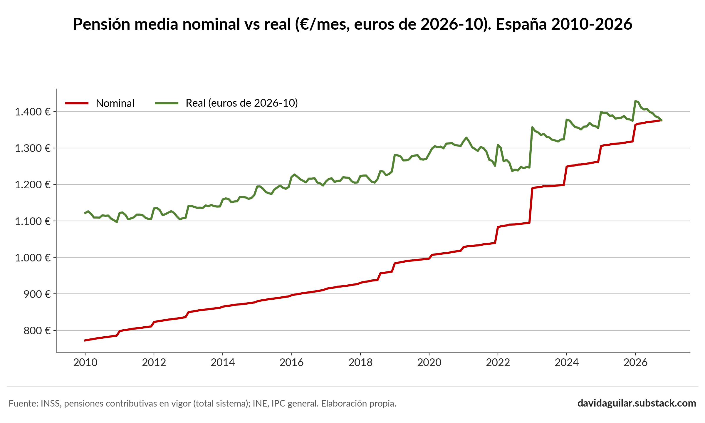
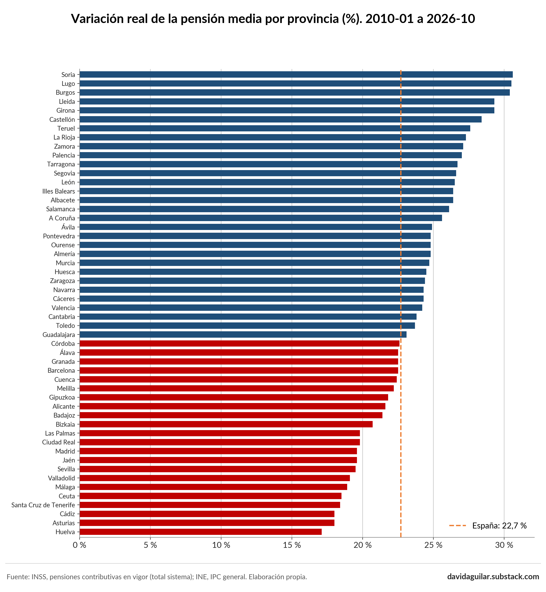

# ¿Por qué la pensión media sube y, aun así, pierde poder adquisitivo?

*Los datos de octubre de 2026 muestran algo que no pasaba desde hace tiempo: la pensión media sube en euros, pero ya no gana a los precios.*

Empiezo por la cifra que me ha hecho levantar la ceja: en octubre de 2026, la pensión media real ha caído un **0,2 %** respecto a octubre de 2025.[^1]

Vamos por partes, porque aquí hay una trampa de palabras. En euros "de los de verdad", es decir, nominales, la pensión media ha subido un **4,6 %** en un año.[^1] Pero los precios también han subido, y al descontar el IPC el resultado es ligeramente negativo. Eso es lo que llamamos variación **real**: lo que puedes comprar con ese dinero, no cuántos euros recibes.

## El punto de partida

La pensión media del sistema contributivo en octubre de 2026 es de **1.376,14 euros al mes**.[^1] Hay **10.565.782 pensiones** en vigor, y en un solo mes se han sumado 18.365 pensiones netas nuevas.[^1] En un año, el número de pensiones ha crecido un **1,6 %**.[^1]

Un matiz que conviene tener claro desde el principio: hablo de **pensiones**, no de **pensionistas**. Una misma persona puede cobrar, por ejemplo, una pensión de jubilación y otra de viudedad. Son cosas distintas y no se pueden mezclar.

## Primer gráfico: nominal frente a real

La línea roja es lo que cobramos en euros de cada momento; la verde es la misma pensión expresada en euros de octubre de 2026, es decir, corrigiendo la inflación. Fíjate en dos cosas. Primero, la tendencia de fondo: desde enero de 2010 la pensión media real ha subido un **22,7 %**.[^2] Segundo, en el tramo final del gráfico la línea verde baja y se junta con la roja: lo que ganábamos frente a los precios se está diluyendo.

Y no afecta a todas las pensiones por igual. En el último año, la pensión media real de jubilación ha caído un **0,4 %**, la de viudedad un **0,6 %** y la de incapacidad permanente un **1,1 %**.[^3]

> [OPINIÓN DE DAVID: ¿Te parece una anomalía puntual o el inicio de un cambio de ciclo? ¿Qué pesa más aquí, la revalorización de enero o el comportamiento de los precios durante el año?]

## Una advertencia importante

Antes de sacar conclusiones, hay que recordar que **la pensión media no es lo mismo que la revalorización**. La media sube también por el llamado *efecto sustitución*: las pensiones nuevas que entran suelen ser más altas que las que se dan de baja.[^1] Es decir, la media puede subir sin que a ningún pensionista concreto le suban su pensión más allá de la revalorización. Por eso este dato describe al conjunto del sistema, no a una persona en particular.

Dicho de otro modo: si incluso con ese empujón de las pensiones nuevas más altas la media real baja, el dato merece que lo miremos con atención.

> [OPINIÓN DE DAVID: ¿Qué lectura haces del efecto sustitución? ¿Es una buena noticia (carreras de cotización más largas y mejores) o es un espejismo estadístico que oculta lo que pasa con quien ya cobra?]

## Segundo gráfico: no todas las provincias son iguales

Si miramos por provincias, el panorama es muy desigual. En el último año, donde más sube la pensión media es en **Cuenca**, con un **5,9 %**, y donde menos es en **Asturias**, con un **3,8 %**.[^1]

Y si ampliamos la mirada a todo el periodo, desde 2010 la mayor subida real la tiene **Soria**, con un **30,6 %**, y la menor **Huelva**, con un **17,1 %**.[^2] La media de España está en el 22,7 % que citaba antes. En el gráfico, las provincias en azul están por encima de la media nacional y las rojas por debajo.

Hay una diferencia enorme entre ambos extremos. Quien cobra la pensión media en Soria ha ganado mucho más poder adquisitivo desde 2010 que quien la cobra en Huelva.

> [OPINIÓN DE DAVID: ¿Cómo explicas esta brecha territorial? ¿Qué papel crees que juegan las carreras de cotización, la estructura productiva y el efecto sustitución en cada provincia?]

## Qué me llevo de este dato

Tres ideas, sin dramatismo:

1. **En euros, la pensión media sube; en poder adquisitivo, ya no.** Un +4,6 % nominal se convierte en un −0,2 % real.[^1]
2. **El balance desde 2010 sigue siendo muy positivo** (+22,7 % real), pero el último tramo cambia de signo.[^2]
3. **El dato nacional esconde mucha variación**: entre provincias, y entre tipos de pensión.

Conviene no pasarse de frenada: un descenso del 0,2 % en un año es pequeño y puede deberse a la evolución de los precios en los últimos meses. Habrá que ver si se confirma en los próximos meses, y es justo el tipo de cosa que me gusta vigilar con datos.

> [OPINIÓN DE DAVID: Cierre. Si esto continuara, ¿qué debería pasar con la revalorización? ¿Y cómo se financia, dado el peso de las pensiones en las cuentas públicas?]

Todos los gráficos y datos están en la web: https://davidaguilar13.github.io/datospensiones.github.io/

---

[^1]: INSS, pensiones contributivas en vigor (total sistema), octubre de 2026. https://www.seg-social.es/wps/portal/wss/internet/EstadisticasPresupuestosEstudios/Estadisticas/EST23/2575 · Las variaciones reales usan además el IPC general del INE: https://www.ine.es/jaxiT3/Tabla.htm?t=50902
[^2]: INSS, pensiones contributivas en vigor (total sistema), e INE, IPC general; variación real de la pensión media entre enero de 2010 y octubre de 2026. https://www.seg-social.es/wps/portal/wss/internet/EstadisticasPresupuestosEstudios/Estadisticas/EST23/2575 · https://www.ine.es/jaxiT3/Tabla.htm?t=50902
[^3]: INSS, pensiones contributivas en vigor (total sistema), e INE, IPC general; variación interanual real por clase de pensión. https://www.seg-social.es/wps/portal/wss/internet/EstadisticasPresupuestosEstudios/Estadisticas/EST23/2575 · https://www.ine.es/jaxiT3/Tabla.htm?t=50902
