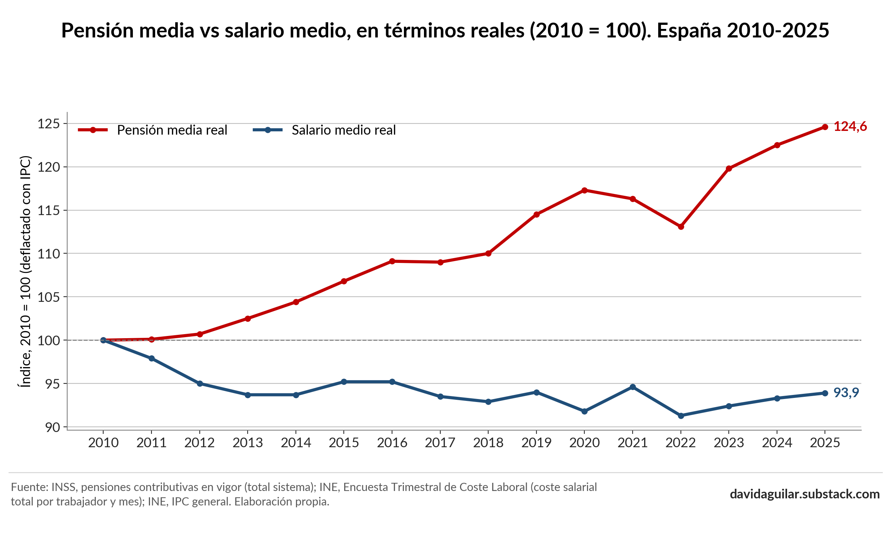
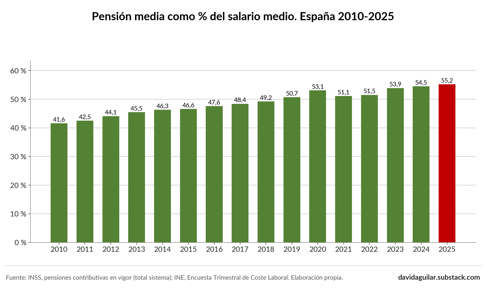

# ¿Quién ha ganado más desde 2010: los pensionistas o los trabajadores?

*Entre 2010 y 2025, la pensión media ha ganado un 24,6 % de poder adquisitivo; el salario medio ha perdido un 6,1 %.*

Empiezo por la cifra que más me llama la atención: entre 2010 y 2025, la pensión media ha crecido un **24,6 %** en términos reales.[^1] En el mismo periodo, el salario medio real ha caído un **6,1 %**.[^2]

Una aclaración antes de seguir, porque aquí todo depende de las palabras. Decir «en términos reales» significa descontar la inflación (el IPC): no miramos cuántos euros llegan a la cuenta, sino cuánto se puede comprar con ellos. Si mi pensión sube un 3 % y los precios un 3 %, en términos reales no he ganado nada.

## Por qué importa

Cuando se habla de pensiones, solemos mirar el gasto total o el número de pensionistas. Pero hay una pregunta más sencilla y más cercana: ¿quién ha mantenido mejor su nivel de vida en estos quince años, quien cobra una pensión o quien cobra una nómina? Los datos de esta web permiten responderla con cifras oficiales, del INSS y del INE, y sin necesidad de fiarse de la memoria ni de la intuición.

Y aviso ya: la respuesta no cuenta toda la historia. Una media es solo eso, una media. Pero es un buen punto de partida para entender hacia dónde apuntan las dos líneas.

## Dos líneas que se separan

Mira el primer gráfico. Tomo 2010 como base (100) y dejo que cada serie evolucione, ya descontado el IPC. La pensión media real termina 2025 en 124,6. El salario medio real, en 93,9.

Lo curioso no es solo la distancia, sino la constancia. Entre 2011 y 2025 hay 15 años de comparación y en **14 de ellos** la pensión media real creció más que el salario real.[^3] La única excepción es 2021. En 2022, con la inflación disparada, la pensión media real sí cayó hasta 113,1, pero el salario real cayó todavía más hasta 91,3.

## Cuánto cobra un pensionista respecto a un trabajador

Otra forma de verlo: dividir la pensión media entre el salario medio. En 2010 la pensión equivalía al **41,6 %** del salario. En 2025, al **55,2 %**.[^4]

En euros: la pensión media mensual de 2025 fue de **1.311,69 €**[^1] y el coste salarial medio por trabajador y mes, de **2.376,55 €**.[^2]

> [OPINIÓN DE DAVID: ¿Es sostenible que las pensiones crezcan más que los salarios que, en buena medida, las financian? ¿Qué crees que dice esta divergencia sobre la productividad y los salarios en España?]

¿Qué se ve en este segundo gráfico? Una escalera casi continua. La proporción sube año tras año, con una pausa en 2021 y 2022, cuando baja respecto a 2020. Cada barra más alta significa que, en promedio, la pensión pesa más en relación con lo que se paga de salario. No es una escalera pequeña: el salto entre 41,6 % y 55,2 % es muy visible.

Conviene no sacar de aquí más de lo que dice. Que la pensión valga más respecto al salario puede deberse a que las pensiones suben, a que los salarios se estancan, o a ambas cosas a la vez. Los datos describen la distancia, no la causa.

## Matices que conviene no olvidar

Los datos no son tan simples como el titular. Estas son las advertencias que acompañan a las cifras:

- **La pensión media no es la revalorización.** Sube también porque las pensiones nuevas son más altas que las que se dan de baja (efecto sustitución). No describe lo que le ha pasado a un pensionista concreto.[^1]
- **El salario es el coste salarial total** por trabajador asalariado y mes: incluye pagas extra prorrateadas y no incluye a los autónomos.[^2]
- **No son magnitudes idénticas.** La pensión media es por pensión (no por pensionista) y en 14 pagas; el salario, por mes en 12. Por eso el cociente pensión/salario sirve para ver la tendencia, no como tasa de sustitución.
- **Son medias anuales de años completos**, de 2010 a 2025.

> [OPINIÓN DE DAVID: ¿Qué te parece que la comparación se haga con medias? ¿Qué echas en falta para valorar de verdad si los trabajadores jóvenes salen perdiendo?]

## Cierre

Con estas cifras, la pregunta no es solo cuánto cobran los pensionistas, sino qué ha pasado con los salarios. Una pensión media que gana poder adquisitivo mientras el salario medio lo pierde es, como mínimo, un dato que merece debate.

> [OPINIÓN DE DAVID: ¿Qué conclusión sacas tú? ¿Es una buena noticia, una señal de alarma, o las dos cosas?]

Todos los gráficos y datos, actualizados, en la web: https://davidaguilar13.github.io/datospensiones.github.io/

---

[^1]: INSS, pensiones contributivas en vigor (total sistema). https://www.seg-social.es/wps/portal/wss/internet/EstadisticasPresupuestosEstudios/Estadisticas/EST23/2575 Deflactado con INE, IPC general (IPC290751): https://www.ine.es/jaxiT3/Tabla.htm?t=50902
[^2]: INE, Encuesta Trimestral de Coste Laboral, coste salarial total por trabajador y mes (ETCL1527). https://www.ine.es/jaxiT3/Tabla.htm?t=6038 Deflactado con INE, IPC general: https://www.ine.es/jaxiT3/Tabla.htm?t=50902
[^3]: Cálculo propio a partir de las fuentes anteriores.
[^4]: INSS, pensiones contributivas en vigor (total sistema), e INE, Encuesta Trimestral de Coste Laboral. Fuentes en las notas 1 y 2.
